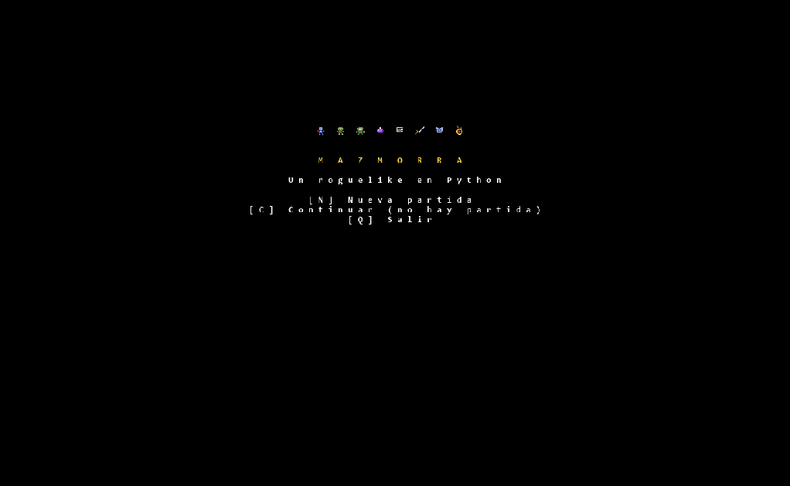

# Mazmorra

Un roguelike 2D hecho en Python con [TCOD](https://python-tcod.readthedocs.io/). Explora mazmorras generadas al azar, pelea contra monstruos, junta objetos y baja 8 pisos para recuperar el **Amuleto de la Mazmorra**.



## Características

- **Mazmorras aleatorias:** salas y túneles distintos en cada piso, con campo de visión y memoria de lo explorado.
- **Gráficos en pixel art** (16×16) desde un archivo PNG que puedes editar.
- **Combate por turnos** contra orcos y trolls, que se vuelven más fuertes a medida que bajas.
- **Inventario:** pociones, pergaminos (rayo, confusión y bola de fuego), armas y armaduras equipables, y soltar objetos.
- **Progresión:** experiencia y niveles; al subir eliges entre +20 vida, +1 poder o +1 defensa.
- **Guardado y carga:** `Esc` guarda la partida y "Continuar" la retoma.
- **Muerte permanente:** si mueres, se borra el guardado.
- **Menús en español:** ayuda, personaje e historial de mensajes.

## Requisitos

- Python 3.9 o superior
- La librería `tcod`

```
pip install tcod
```

## Cómo ejecutarlo

Deja **`mazmorra.py` y `tiles.png` en la misma carpeta** y ejecuta:

```
python mazmorra.py
```

> **Si tienes varias versiones de Python instaladas**, usa la misma con la que instalaste `tcod`. Por ejemplo:
> `py -3.11 mazmorra.py`, o instala la librería con el mismo intérprete: `python -m pip install tcod`.

## Cómo se juega

Baja por las escaleras (`>`) hasta el piso 8, donde está el amuleto. Recógelo para ganar.

| Acción | Tecla |
| --- | --- |
| Moverte y atacar | Flechas, `h j k l y u b n` o teclado numérico |
| Esperar un turno | `.` o `5` |
| Recoger un objeto | `g` o `,` |
| Inventario (usar o equipar) | `i` |
| Soltar un objeto | `d` |
| Bajar escaleras | `>` o `Enter` (sobre el símbolo de escaleras) |
| Personaje | `c` |
| Historial de mensajes | `v` |
| Ayuda | `?` |
| Guardar y volver al menú | `Esc` |

### Objetos

| Objeto | Efecto |
| --- | --- |
| Poción de curación | Recupera 15 de vida |
| Pergamino del rayo | 20 de daño al enemigo más cercano a la vista |
| Pergamino de confusión | El enemigo más cercano se mueve al azar durante 8 turnos |
| Pergamino de bola de fuego | 12 de daño en un área alrededor del enemigo más cercano (no te daña a ti) |
| Daga, Espada | Aumentan tu poder de ataque al equiparlas |
| Armadura de cuero, Cota de malla | Aumentan tu defensa al equiparlas |

Al bajar de piso recuperas la mitad de tu vida. Además, regeneras 1 punto de vida cada 10 turnos.

## Archivos del proyecto

| Archivo | Descripción |
| --- | --- |
| `mazmorra.py` | El juego completo |
| `tiles.png` | Hoja de gráficos: sprites y letras del texto |
| `make_tiles.py` | Script que genera `tiles.png` (solo para modificar los gráficos) |
| `partida.sav` | Se crea al guardar. Es tu partida; puedes borrarla para empezar de cero |

## Personalizar

- **Dificultad:** en `mazmorra.py`, los objetos están en la lista `SPECS` y los monstruos en `make_monster`. Cambia vida, poder, defensa o frecuencia.
- **Número de pisos:** cambia `MAX_DEPTH`.
- **Gráficos:** edita los dibujos del diccionario `SPRITES` en `make_tiles.py` y ejecútalo (`pip install pillow` y luego `python make_tiles.py`). También puedes editar `tiles.png` con un editor de pixel art, manteniendo la hoja en 16×16 tiles de 16 píxeles y sin mover las posiciones.

## Solución de problemas

- **`No module named 'tcod'`:** `tcod` está instalado en otra versión de Python. Mira el aviso de la sección "Cómo ejecutarlo".
- **`Falta tiles.png`:** el archivo debe estar en la misma carpeta que `mazmorra.py`.
- **No se escriben algunos comandos como `>`:** usa `Enter` para bajar escaleras, que hace lo mismo.
- **La ventana no cabe en pantalla:** es redimensionable; arrastra los bordes o maximízala y se escala.

## Créditos

- Hecho con Python y [python-tcod](https://github.com/libtcod/python-tcod).
- Texto del juego con la fuente DejaVu Sans Mono (licencia libre de Bitstream Vera).
- Inspirado en el género roguelike y en el tutorial *Yet Another Roguelike Tutorial*. El código y los gráficos de este proyecto son propios.

## Licencia

<!-- TODO: elige una licencia (por ejemplo MIT) o indica que es de uso personal -->
